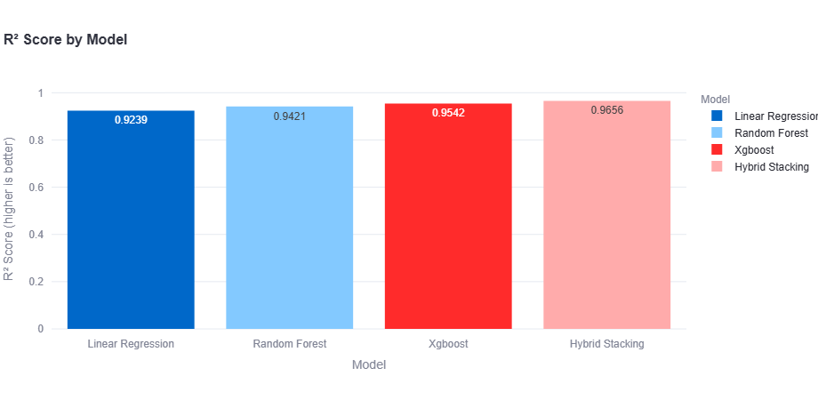
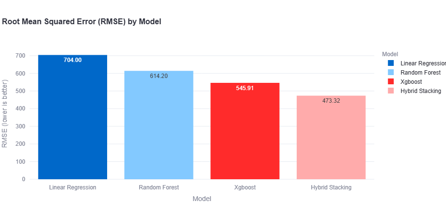

 
 # Rossmann Sales Forcasting
 
### End-to-end retail sales forecasting with machine learning and an interactive Streamlit dashboard
 

 

 
## 🎯 Project Overview
 
Rossmann operates thousands of drug stores across Europe, and store managers need to predict daily sales to plan staffing, inventory, and promotions. Sales are shaped by promotions, competition, school and state holidays, seasonality, and store characteristics, which makes accurate forecasting challenging.
 
**This project tackles that problem end to end.** It takes the raw Rossmann sales data through cleaning, feature engineering, model training, and forecasting, then turns the forecasts into practical business insights. Everything is brought together in an interactive Streamlit dashboard (`dashboard_copy.py`):
 
**Load data → Explore → Preprocess → Train models → Forecast → Business insights**
 
## 🏆 Key Results
 
| Best model | RMSE | R² |
|---|---|---|
| **XGBoost** | **545.91** | **0.9542** |
 
XGBoost reduced RMSE by about **22%** compared with the Linear Regression baseline (704.00 → 545.91).
 
## ✨ Highlights
 
- 📊 Interactive exploratory analysis with Plotly charts and a correlation heatmap
- 🛠️ Feature engineering with date, lag, rolling-average, promotion, and interaction features
- 🤖 Automatic comparison of three models, with the best one (lowest RMSE) used for forecasting
- 📏 Evaluation with RMSE, MAE, MAPE, and R²
- 🔮 Forecasts for 7 to 30 days ahead, for any selection of stores
- 💡 Automatic business insights: top store, best sales day, promotion lift, and weekend lift
## 📦 Dataset
 
| | |
|---|---|
| **Name** | Rossmann Store Sales |
| **Source** | Kaggle |
| **Link** | 🔗 [kaggle.com/c/rossmann-store-sales/data](https://www.kaggle.com/c/rossmann-store-sales/data) |
| **Files used** | `train.csv` (historical daily sales), `store.csv` (store information) |
| **Coverage** | 1,115 Rossmann stores |
 
The two files are merged on `Store`. Days when a store was closed (`Sales = 0`) are removed, and missing values in competition and promotion columns are filled with the column median (`PromoInterval` is filled with an empty string).
 
## 🧬 Features Used
 
### Original features
 
| Feature | Source | Description |
|---|---|---|
| `Store` | train.csv | Store ID |
| `DayOfWeek` | train.csv | Day of the week (1 = Monday, 7 = Sunday) |
| `Promo` | train.csv | Whether the store ran a promotion that day |
| `SchoolHoliday` | train.csv | Whether the store was affected by a school holiday |
| `StoreType` | store.csv | Store model type (a, b, c, d) |
| `Assortment` | store.csv | Assortment level (a = basic, b = extra, c = extended) |
| `CompetitionDistance` | store.csv | Distance to the nearest competitor |
| `CompetitionOpenSinceMonth` / `CompetitionOpenSinceYear` | store.csv | When the nearest competitor opened |
| `Promo2` | store.csv | Whether the store takes part in a continuing promotion |
| `Promo2SinceWeek` / `Promo2SinceYear` | store.csv | When the store joined the continuing promotion |
 
### Engineered features
 
| Group | Features | Description |
|---|---|---|
| **Date features** | `Year`, `Month`, `Day`, `WeekOfYear` | Calendar components extracted from `Date` |
| **Weekend flag** | `IsWeekend` | 1 for Saturday and Sunday |
| **Lag features** | `Sales_Lag1`, `Sales_Lag2`, `Sales_Lag3`, `Sales_Lag7`, `Sales_Lag14`, `Sales_Lag30` | Past sales of the same store, shifted by 1, 2, 3, 7, 14, and 30 days |
| **Rolling averages** | `Sales_MA7`, `Sales_MA14`, `Sales_MA30` | 7-, 14-, and 30-day moving averages of sales per store |
| **Promotion month** | `IsPromoMonth` | 1 if the current month falls inside the store's `PromoInterval` |
| **One-hot encoding** | `StoreType_*`, `Assortment_*` | Dummy variables for store type and assortment |
| **Interaction features** | `Promo_Weekend`, `Promo_SchoolHoliday` | Promotion combined with weekend and school-holiday flags |
| **Scaled feature** | `CompetitionDistance_Scaled` | Standardized competition distance |
 
**Target variable:** `Sales`
**Excluded from the model inputs:** `Date`, `Sales`, `Customers`
 
Lag and rolling features are computed separately for each store, and missing values created by shifting are filled with the column mean.
 
## 🧠 Models
 
| Model | Type |
|---|---|
| Linear Regression | Baseline model |
| Random Forest | Tree ensemble |
| XGBoost | Gradient boosting |
 
## 📊 Results
 
| Model | RMSE ↓ | R² ↑ |
|---|---|---|
| Linear Regression | 704.00 | 0.9239 |
| Random Forest | 614.20 | 0.9421 |
| **XGBoost** | **545.91** | **0.9542** |
 
**XGBoost performed best**, with the lowest RMSE and the highest R². Each step up in model complexity improved on the one before it.
 

  
  

> Results come from the dashboard's 5-store demo subset, evaluated on the last 14 days of data.
 
## 🗂️ Dashboard Pages
 
| Page | Description |
|---|---|
| **Overview** | Project intro, dataset preview, and headline stats (stores, date range, average and total sales) |
| **Data Exploration** | Sales by store, day of week, and store type; sales trend over time; promo impact; correlation matrix |
| **Data Preprocessing** | Feature engineering, original vs. engineered features, and the train/test split (last 14 days held out) |
| **Model Training** | Trains and evaluates all models, compares metrics, shows Random Forest feature importance and the best model |
| **Forecasting** | Forecast tables, charts, and per-store timelines for 7 to 30 days ahead |
| **Business Insights** | Promotion lift, weekend vs. weekday lift, top store, best day, and recommendations |
 
 
## 🛠️ Tech Stack
 
- **App:** Streamlit
- **Data:** pandas, NumPy
- **Visualization:** Plotly, Matplotlib, Seaborn
- **Machine Learning Models:**
  - Linear Regression (scikit-learn)
  - Random Forest Regressor (scikit-learn)
  - XGBoost
    
## ⚠️ Notes
 
- For speed, the dashboard uses the **first 5 stores** as a demo subset.
- Future promotion and school-holiday flags are generated randomly (about 30% promo, 20% school holiday), so forecasts reflect assumed patterns rather than a real promotion calendar.

